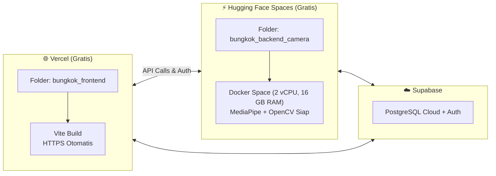

# 📐 BUNGKOK Master UI/UX Specification & Production Hosting Blueprint

Dokumen ini disusun sebagai **Master Blueprint & Prompt Referensi Lengkap** agar AI lain (atau pengembang UI/UX) dapat memahami arsitektur, merancang antarmuka (UI) kelas dunia (*Awwwards-grade*), menyempurnakan interaksi visual, serta memastikan proyek siap di-hosting ke produksi (*Vercel + Hugging Face Spaces*).

---

## 🧭 1. Ringkasan Proyek & Arsitektur Sistem

* **Nama Proyek:** **BUNGKOK** (*Sistem Deteksi Postur Duduk Membungkuk Real-Time*)
* **Teknologi AI:** MediaPipe Pose (BlazePose) 33 3D Keypoints + Artificial Neural Network (ANN) Klasifikasi $6 \to 64 \to 128 \to 32 \to 1$ + 6 Vektor Geometri Biomekanika ($f_1$ s/d $f_6$).
* **Fitur Utama (Dual-POV):**
  1. **POV Depan (`upper_body`):** Webcam laptop internal (leher, telinga, bahu, kompresi servikal, Forward Head Posture/FHP).
  2. **POV Samping (`full_torso`):** Kamera smartphone nirkabel melalui scan **QR Code via WebRTC P2P (Google STUN)** tanpa install aplikasi di HP.
* **Tech Stack Frontend:** React 18, Vite 6, React Router v6, GSAP 3, Lenis Smooth Scroll, PeerJS (WebRTC), Lucide Icons, Soft-UI Design System.
* **Tech Stack Backend:** Python 3.11, FastAPI, MediaPipe, NumPy, Docker, Supabase (PostgreSQL + Auth).

---

## 🎨 2. Design System & Bahasa Visual (Soft-UI / Clean Ergonomic)

Antarmuka BUNGKOK mengusung estetika **Ergonomic Soft-UI** (modern, ramah, tidak kaku, minim distraksi visual):

### A. Palet Warna (Color Tokens)
* **Primary Accent:** `#0284c7` (Sky Blue) & `#0369a1` (Deep Sky).
* **Alert / CTA Pink:** `#f43f5e` (Energetic Pink/Rose) untuk tombol aksi utama dan indikator peringatan bungkuk.
* **Good Posture Green:** `#16a34a` / `#22c55e` (Emerald Green) untuk postur tegak dan status koneksi aktif.
* **Bad Posture Warning:** `#ea580c` / `#ef4444` (Amber/Red) untuk postur bungkuk melengkung.
* **Background Canvas:** `#f8fafc` (Slate 50) dengan kartu putih bersih `#ffffff` dan bayangan lembut `0 10px 25px -5px rgba(0, 0, 0, 0.05)`.
* **Dark Mode Mobile Viewfinder:** `#0f172a` (Slate 900) dengan border `#334155` untuk menghemat baterai HP.

### B. Tipografi & Hierarki
* **Font Family:** `Geist Variable`, `Inter`, atau `system-ui`.
* **Ukuran & Berat:**
  * Judul Halaman: `28px` – `32px`, Bold (`700`).
  * Judul Kartu: `18px` – `20px`, Semi-bold (`600`).
  * Body Text: `14px` – `15px`, Regular (`400`), line-height `1.5`.
  * Status Badge & Micro-labels: `11px` – `12px`, Medium (`500`).

---

## 🖥️ 3. Spesifikasi 4 Komponen Antarmuka Utama

### 📱 Komponen 1: Mobile Side Camera Broadcaster (`/cam/side`)
* **File Target:** `bungkok_frontend/src/pages/MobileSideCamera.jsx`
* **Peran:** Dibuka langsung saat smartphone melakukan scan QR Code di laptop.
* **Kebutuhan UI/UX:**
  1. **Zero-Login Requirement:** Wajib 100% publik, tidak boleh diarahkan ke `/login` atau meminta otentikasi.
  2. **Viewfinder Responsif:** Menampilkan pratinjau kamera belakang (`facingMode: "environment"`) layar penuh dengan aspect ratio `4:3` yang proporsional di layar HP vertikal/horizontal.
  3. **Visual Alignment Guide:** Overlay siluet transparan dengan teks petunjuk: *"Letakkan HP di samping meja sejajar bahu & pinggul (jarak 1 – 1.5 meter)"*.
  4. **Pill Status Koneksi WebRTC:**
     * Biru berkedip: `Menghubungkan ke laptop...`
     * Hijau menyala: `🟢 Terhubung ke Laptop (Kamera Samping Aktif)`
     * Merah: `Koneksi terputus (Coba Sambungkan Ulang)`
  5. **Kontrol Sederhana:** Tombol *Balik Kamera (Depan/Belakang)* dan tombol *Kunci Orientasi*.

---

### 💻 Komponen 2: Modal QR Code Pairing (`PhoneCameraModal.jsx`)
* **File Target:** `bungkok_frontend/src/components/camera/PhoneCameraModal.jsx`
* **Peran:** Modal elegan di laptop saat pengguna memilih mode kamera "Samping".
* **Kebutuhan UI/UX:**
  1. **Otomatis Muncul:** Begitu pengguna mengklik radio button *"Samping"*, modal QR Code ini langsung terbuka secara otomatis tanpa perlu klik tombol ekstra.
  2. **Render QR Code Kontras Tinggi:** Menggunakan `<QRCodeSVG />` ukuran `190px` di atas kanvas putih berbingkai garis putus-putus biru.
  3. **Indikator Deteksi Localhost vs Domain Publik:**
     * Jika dibuka di domain publik (Vercel): QR code otomatis memakai URL domain publik.
     * Jika dibuka di `localhost`: Menampilkan kotak bantuan ramah dengan opsi paste tunnel Cloudflare atau tombol 1-klik IP Wi-Fi lokal.
  4. **Transisi Instan Saat HP Terkoneksi:** Begitu WebRTC tersambung, QR code menghilang dan berganti dengan pratinjau video langsung dari HP (*Live Feed HP Samping*) disertai tombol konfirmasi hijau: *"Gunakan Kamera Samping Ini"*.

---

### 📊 Komponen 3: Live Dashboard Camera Card (`Dashboard.jsx`)
* **File Target:** `bungkok_frontend/src/pages/Dashboard.jsx` (`LiveDashboardCamera`)
* **Peran:** Menampilkan video langsung dan indikator AI saat pemantauan sedang berjalan.
* **Kebutuhan UI/UX:**
  1. **Dual Layer:** Elemen `<video>` di lapisan bawah dan elemen `<canvas>` transparan di lapisan atas untuk menggambar garis kerangka tulang (*Skeleton 33 landmarks*).
  2. **Warna Kerangka Adaptif:**
     * Hijau cerah (`#22c55e`): Postur tegak ideal.
     * Oranye/Merah (`#ef4444`): Terdeteksi membungkuk (*slouching* / FHP).
  3. **Floating Status Capsule:** Badge melayang di sudut video: `● Pemantauan postur aktif` atau `● Tegakkan posturmu!`.
  4. **Quick Action Dock:** Tombol *Buka Monitor*, *Jeda*, dan *Selesai*.

---

### 🪟 Komponen 4: Modal Sesi Latihan & Kalibrasi (`StartExerciseModal.jsx`)
* **File Target:** `bungkok_frontend/src/components/dialogs/StartExerciseModal.jsx`
* **Peran:** Alur 5 langkah: Persiapan $\to$ Kalibrasi 5 Detik $\to$ Atur Sesi $\to$ Latihan $\to$ Rekap.
* **Kebutuhan UI/UX:**
  1. **Pilihan Posisi Kamera Bersih:**
     * Pilihan `Depan`: Menampilkan dropdown webcam laptop dan tombol pink *"Aktifkan kamera"*.
     * Pilihan `Samping`: **Menyembunyikan dropdown kamera laptop sepenuhnya**, langsung memunculkan QR Code HP, dan mengubah tombol utama menjadi *"Scan QR Code Kamera HP"*.
  2. **Hitung Mundur Kalibrasi 5 Detik:** Animasi angka melayang besar yang memandu pengguna duduk tegak rileks untuk merekam baseline biomekanika personal.

---

## 🚀 4. Production Hosting & Deployment Runbook

Berikut adalah panduan bagi pengguna untuk langsung meng-online-kan proyek secara **100% GRATIS & TANPA KARTU KREDIT**:



### Langkah 1: Deploy Backend AI ke Hugging Face Spaces
1. Buka [huggingface.co](https://huggingface.co) $\to$ **New Space**.
2. Beri nama: `bungkok-backend`.
3. Pilih **SDK: Docker** $\to$ **Blank**.
4. Pilih Hardware: **CPU basic • 2 vCPU • 16GB RAM • FREE**.
5. Upload seluruh file di folder `bungkok_backend_camera` (termasuk `Dockerfile`, `requirements.txt`, folder `model`, dan `app.py`).
6. Masukkan Environment Variable di tab **Settings**:
   * `FRONTEND_ORIGINS` = `*`
   * `DATABASE_URL` = Connection string PostgreSQL Supabase Anda.
   * `PORT` = `7860`
7. Space akan otomatis me-*build* dan memberikan URL HTTPS:
   `https://<username>-bungkok-backend.hf.space`

### Langkah 2: Deploy Frontend ke Vercel
1. Buka [vercel.com](https://vercel.com) $\to$ **Add New Project**.
2. Pilih repositori GitHub Anda.
3. Set **Root Directory:** `bungkok_frontend`.
4. Framework Preset: **Vite**.
5. Masukkan Environment Variables:
   * `VITE_API_URL` = `https://<username>-bungkok-backend.hf.space`
   * `VITE_SUPABASE_URL` = `https://<ref>.supabase.co`
   * `VITE_SUPABASE_ANON_KEY` = `anon_key_supabase_anda`
6. Klik **Deploy**. Web BUNGKOK akan langsung live di `https://bungkok.vercel.app`.

---

## 🤖 5. Copy-Pasteable Prompt untuk AI Desainer / Frontend

Jika Anda ingin mendelegasikan tugas pemolesan UI kepada AI lain, salin prompt di bawah ini:

```markdown
Halo! Anda bertindak sebagai Senior Frontend Designer & Creative Technologist.
Tugas Anda adalah memoles dan menyempurnakan antarmuka (UI/UX) pada proyek "BUNGKOK" (Sistem Deteksi Postur Duduk 3D Real-Time).

Prinsip & Aturan Desain Utama:
1. Bahasa Visual: Soft-UI Ergonomis dengan aksen Sky Blue (#0284c7) dan Energetic Pink (#f43f5e) untuk peringatan bungkuk. Hindari template AI generik (anti-slop).
2. Mode Kamera Samping (Dual-POV):
   - Rute `/cam/side` di `bungkok_frontend/src/pages/MobileSideCamera.jsx` adalah antarmuka khusus smartphone via WebRTC. Halaman ini WAJIB 100% bebas login (zero authentication).
   - Pastikan tampilan viewfinder di HP bersih, aspect ratio 4:3 tidak terdistorsi, ada overlay siluet tubuh samping, dan tombol flip camera mudah dijangkau satu tangan.
3. Modal QR Code di Laptop:
   - Komponen `PhoneCameraModal.jsx` harus otomatis menampilkan QR Code beresolusi tajam saat opsi "Samping" dipilih.
   - Saat stream HP tersambung, tampilkan transisi mulus ke pratinjau live feed HP.
4. Dashboard Live Card:
   - Komponen `LiveDashboardCamera` di `Dashboard.jsx` harus menampilkan video stream aktif (baik dari webcam laptop maupun kamera samping HP) beserta skeleton MediaPipe di atas canvas secara real-time.

Semua dependensi (`peerjs`, `qrcode.react`, `lucide-react`, `gsap`, `lenis`) sudah terpasang. Pastikan `npm run build` tetap lulus dengan 0 error.
```
