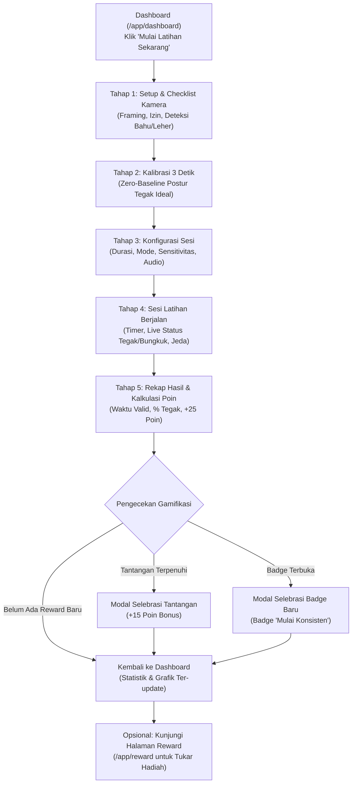

# Spesifikasi Eksekusi: Alur Latihan, Kalibrasi & Gamifikasi Bungkok

Dokumen spesifikasi teknis dan alur antarmuka pengguna (*Frontend Execution Blueprint*) untuk mengimplementasikan alur latihan postur tubuh terpadu pada aplikasi **Bungkok**, mulai dari tombol **"Mulai Latihan Sekarang"** di Dashboard hingga siklus gamifikasi perolehan badge dan penukaran reward.

---

## 1. Diagram Alur Pengguna (*User Flow State Machine*)



---

## 2. Rincian Alur Layar & Kebutuhan Konten

### Tahap 1: Persiapan & Checklist Kamera (`SETUP_CHECK`)
* **Tujuan:** Memastikan kondisi fisik dan kamera memenuhi standar pemrosesan model AI.
* **Elemen Antarmuka:**
  - **Pratinjau Video (Webcam):** Menggunakan `navigator.mediaDevices.getUserMedia({ video: true })`.
  - **Panduan Siluet (Silhouette Overlay):** Garis batas panduan kepala dan bahu di tengah bingkai.
  - **Checklist Kesiapan:**
    - [x] Izin kamera aktif
    - [x] Pencahayaan ruangan memadai
    - [x] Bahu kiri dan kanan terlihat dalam bingkai
  - **Tombol Aksi:** `[ Lanjut ke Kalibrasi ]` (Aktif hanya jika checklist terpenuhi).

---

### Tahap 2: Kalibrasi Postur Netral (`CALIBRATION`)
* **Tujuan:** Menetapkan titik nol ($0^\circ$ baseline) posisi duduk tegak alami pengguna.
* **Instruksi Pengguna:** *"Tarik bahu ke belakang, tegakkan tulang belakang, tatap lurus ke layar."*
* **Elemen Antarmuka:**
  - Tombol pemicu `[ Mulai Kalibrasi ]`.
  - Animasi hitung mundur melingkar (*circular countdown ring*): **3... 2... 1...**.
  - Nilai referensi tersimpan: `baselineAngle = 86°`.
  - Efek audio/visual: Suara *soft chime* + tag hijau *"Kalibrasi Berhasil"*.
  - **Trigger Gamifikasi:** Jika ini kalibrasi pertama, siapkan trigger untuk badge **"Kalibrasi Siap"**.
  - **Tombol Aksi:** `[ Atur Sesi Latihan ]`.

---

### Tahap 3: Konfigurasi Parameter Sesi (`SESSION_SETUP`)
* **Tujuan:** Mengumpulkan preferensi latihan pengguna sebelum sesi aktif dimulai.
* **Elemen Antarmuka:**
  - **Pilihan Mode Latihan:**
    - `Mode Duduk Kerja`: Peringatan bungkuk santai (toleransi jeda 10 detik).
    - `Mode Koreksi Aktif`: Peringatan cepat (respons bungkuk 3 detik).
  - **Pilihan Target Durasi:** Chips selector `15 Menit`, `25 Menit (Fokus)`, `30 Menit`.
  - **Tingkat Sensitivitas Kemiringan:** `Ketat (10°)`, `Normal (15°)`, `Santai (20°)`.
  - **Toggle Suara:** Aktifkan/nonaktifkan audio alarm pengingat bungkuk.
  - **Tombol Aksi:** `[ Mulai Latihan Sekarang ]` (Membuka layar sesi aktif).

---

### Tahap 4: Sesi Pemantauan Aktif (`SESSION_ACTIVE`)
* **Tujuan:** Menemani aktivitas duduk pengguna dengan umpan balik postur waktu-nyata.
* **Elemen Antarmuka:**
  - **Timer Digital:** Countup / Countdown format `MM:SS`.
  - **Indikator Status Postur Real-Time:**
    - 🟢 **Postur Tegak:** Badge hijau cerah (*"Postur terjaga dengan baik"*).
    - 🔴 **Bungkuk Terdeteksi:** Badge oranye/pink berdenyut (*"Punggung condong ke depan, tegakkan kembali"*) + audio peringatan jika > 5 detik.
  - **Mini Live Metric:** Persentase tegak sesi berjalan (misal: `82%`).
  - **Tombol Kontrol:**
    - `[ Ambil Jeda ]`: Menjeda pencatatan, masuk ke status *pause* (akumulasi ke tantangan "Ingat Jeda").
    - `[ Selesaikan Sesi ]`: Mengakhiri sesi lebih awal dan memproses data.

---

### Tahap 5: Rekap Hasil & Kalkulasi Poin (`SESSION_SUMMARY`)
* **Tujuan:** Menampilkan hasil evaluasi sesi secara transparan dan memberikan poin pencapaian.
* **Elemen Antarmuka:**
  - **Kartu Ringkasan:**
    - Durasi Total: `25 Menit`
    - Waktu Valid: `25 Menit`
    - Postur Tegak: `80%` (20 menit tegak, 5 menit bungkuk terkoreksi)
    - Peringatan Bunyi: `3 Kali`
  - **Perolehan Poin:**
    - Rumus: $1\text{ Poin} = 1\text{ Menit Valid}$ (Maksimal 25 poin per sesi).
    - Badge Poin: `+25 Poin Ditambahkan ke Saldo`.
  - **Progress Bar Level:**
    - Menampilkan kenaikan saldo dari `185` menjadi `210 poin`.
    - Progres level: `210 / 250 Poin (Level 3 - Pembentuk Kebiasaan)`.

---

### Tahap 6: Evaluasi Gamifikasi (Badge, Tantangan & Reward Shop)
* **Tujuan:** Memberikan dopamin dan retensi pengguna melalui *gamification loop*.
* **Logika Evaluasi Otomatis:**
  1. **Tantangan "Tiga Hari Mulai":**
     - Sesi valid hari ini menambahkan progres dari `2/3 hari` menjadi `3/3 hari`.
     - Muncul banner selebrasi: **🎉 Tantangan Selesai! Hadiah: +15 Poin Bonus.**
  2. **Tantangan "Ingat Jeda":**
     - Jika pengguna sempat menekan tombol jeda, progres bertambah dari `3/5` ke `4/5 jeda`.
  3. **Pencapaian Badge Baru:**
     - Jika memenuhi syarat (misal: latihan 3 hari berbeda tercapai), muncul modal selebrasi:
       - Judul: **Badge "Mulai Konsisten" Terbuka! 🏆**
       - Subtitle: *"Kamu sudah berlatih di 3 hari yang berbeda."*
  4. **Peluang Belanja Hadiah Virtual:**
     - Saldo baru: $185 + 25 + 15 = \mathbf{225\text{ Poin}}$.
     - Teks ajakan: *"Poinmu sekarang cukup untuk menukar **Bingkai Cloud (150 poin)** atau **Tema Sky Morning (100 poin)** di menu Reward."*
  - **Tombol Aksi:**
    - `[ Kunjungi Toko Hadiah ]` $\rightarrow$ Navigasi ke `/app/reward`.
    - `[ Selesai & Kembali ke Dashboard ]` $\rightarrow$ Menutup modal dan menyinkronkan seluruh kartu dashboard.

---

## 3. Kontrak State & Integrasi `AppContext.jsx`

Data sesi baru harus langsung meng-update state global agar Dashboard dan halaman Riwayat langsung tersinkron tanpa refresh:

```javascript
// Contoh payload sesi baru yang di-dispatch ke AppContext
const completedSession = {
  id: `sesi-${Date.now()}`,
  date: '14 Jul',
  fullDate: '14 Jul 2025',
  time: '14.30',
  timeRange: '14.30–14.55 WIB',
  totalDuration: '25m',
  validDuration: '25m',
  uprightDuration: '20m',
  uprightPercentage: 80,
  forwardLean: '4m',
  forwardLeanPercentage: '16%',
  backwardLean: '1m',
  backwardLeanPercentage: '4%',
  pauseDuration: '0m',
  unmonitoredDuration: '0m',
  remindersCount: 3,
  coverage: 100,
  pointsEarned: 25,
  status: 'Selesai',
};
```

### Mutasi State yang Terjadi:
* `user.points` $\leftarrow$ Bertambah $+25$ (atau $+40$ jika klaim bonus tantangan).
* `user.totalPointsCumulative` $\leftarrow$ Bertambah $+25$.
* `sessions` $\leftarrow$ `[completedSession, ...sessions]`.
* `challenges[0].current` $\leftarrow$ Bertambah menjadi $3$ (Status selesai).

---

## 4. Checklist Eksekusi Bertahap (Sprint Roadmap)

- [ ] **Langkah 1: Perombakan Komponen Modal Latihan**
  - Buat komponen wizard bertahap di `src/components/dialogs/StartExerciseModal.jsx` (atau perbarui `CameraDialog.jsx`).
  - Sediakan transisi antar langkah (`SETUP` $\rightarrow$ `CALIBRATING` $\rightarrow$ `CONFIG` $\rightarrow$ `RUNNING` $\rightarrow$ `SUMMARY`).
- [ ] **Langkah 2: Simulasi Deteksi & Audio Feedback**
  - Implementasikan audio synthesizer atau file web audio sederhana untuk nada pengingat (*beep* halus).
  - Buat simulasi deteksi bungkuk interaktif (toggle manual / interval) untuk kebutuhan demo sebelum model AI backend dihubungkan.
- [ ] **Langkah 3: Sinkronisasi State Global**
  - Tambahkan fungsi `completeSession(sessionData)` dan `updateChallengeProgress()` di `src/context/AppContext.jsx`.
- [ ] **Langkah 4: Modal Selebrasi Reward / Badge**
  - Buat komponen modal pop-up selebrasi saat tantangan selesai atau badge baru terbuka dengan efek animasi halus (GSAP).
- [ ] **Langkah 5: Verifikasi Dashboard**
  - Uji tombol **"Mulai Latihan Sekarang"** di `Dashboard.jsx`, jalankan sesi singkat, selesaikan, dan pastikan kartu statistik atas, grafik mingguan, serta sesi terbaru langsung ter-update secara otomatis.
